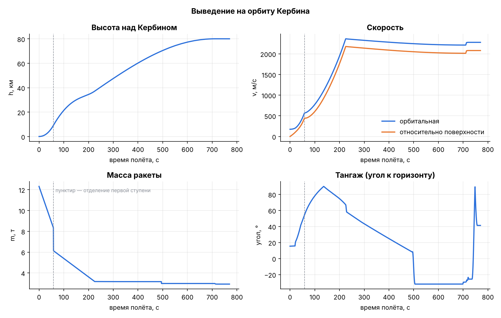
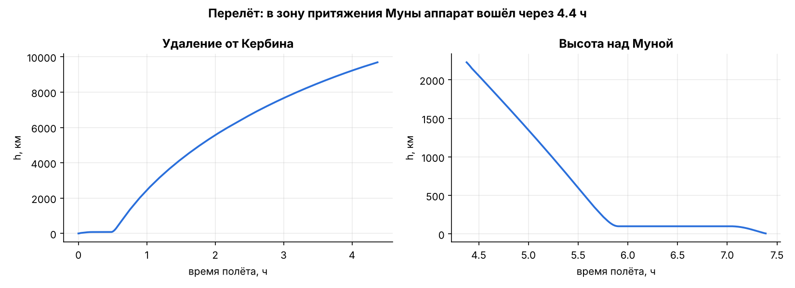
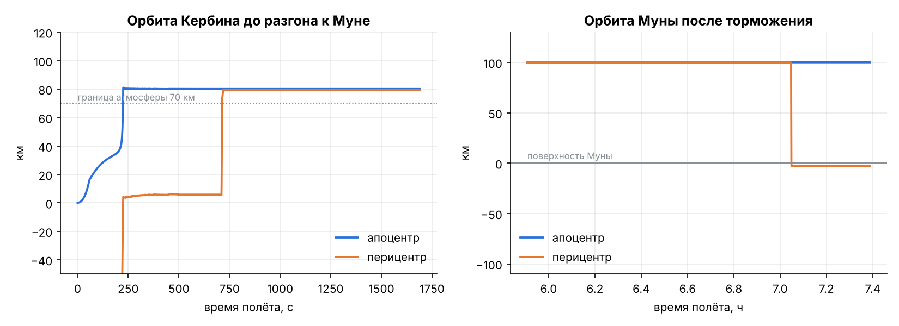
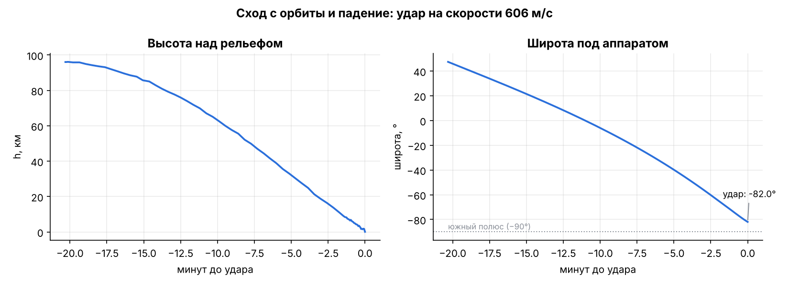
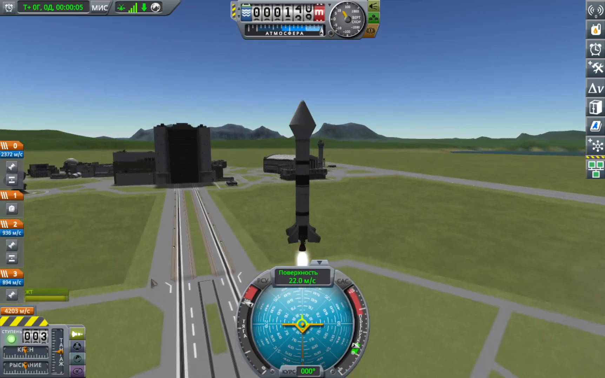
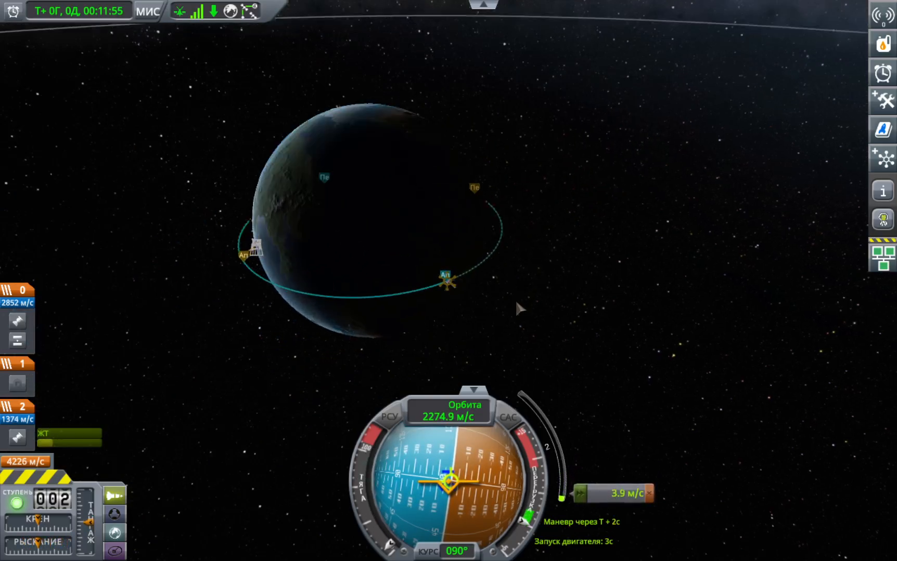
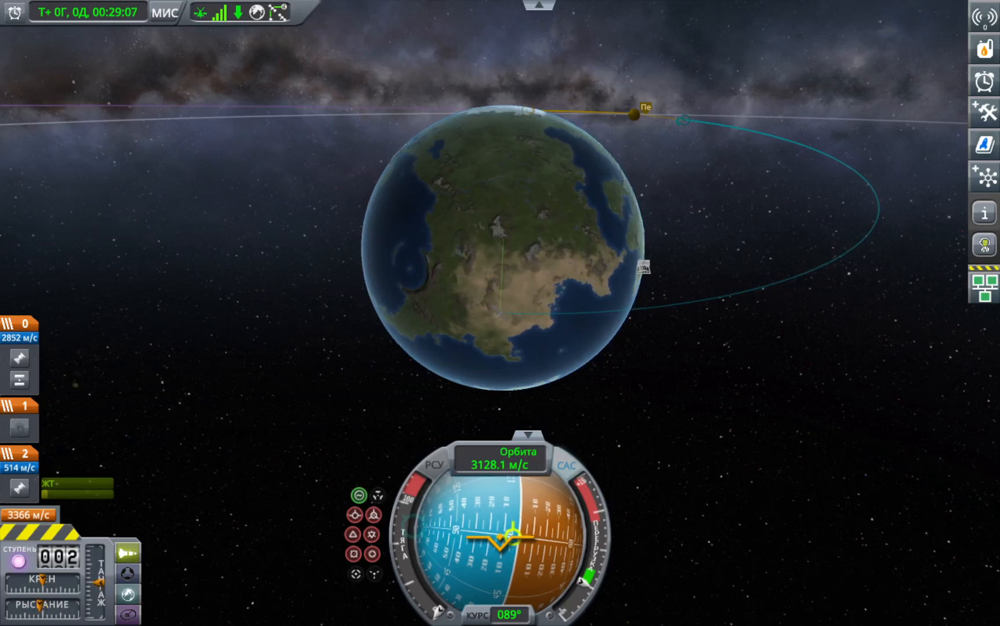
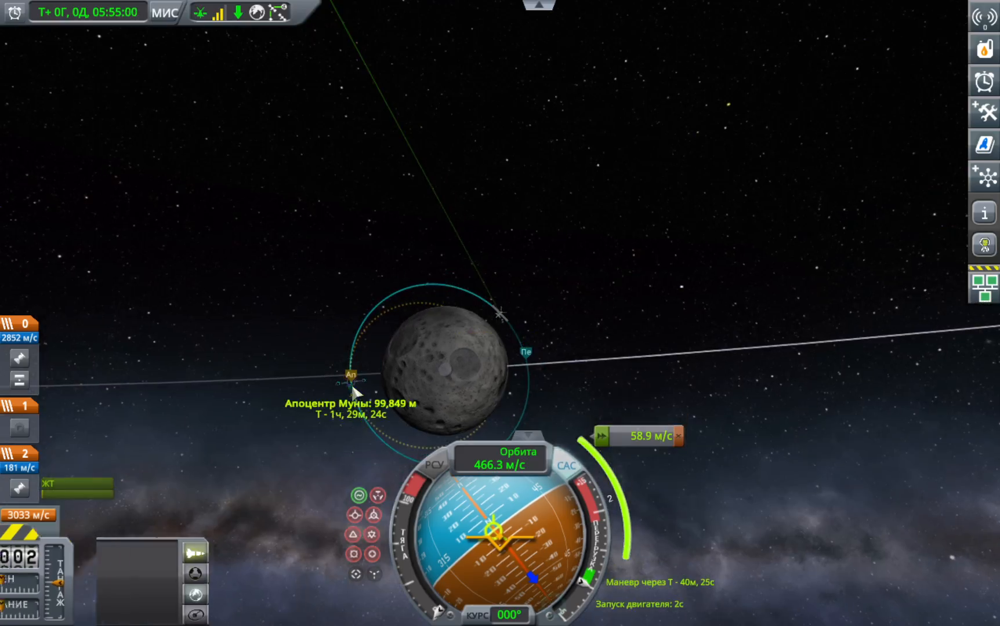
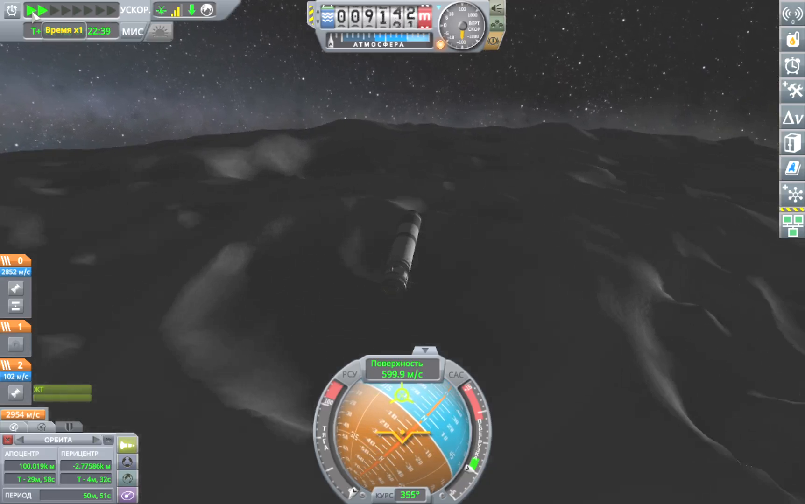
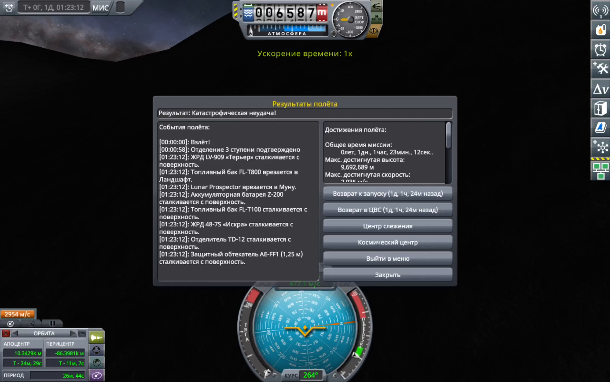

<div align="center">


# Lunar Prospector в KSP

**Моделирование лунной миссии NASA 1998 года в Kerbal Space Program**

</div>

## О проекте

**Lunar Prospector** — станция NASA, которая в 1998–1999 годах изучала Луну с полярной орбиты и нашла признаки водяного льда у полюсов. В конце миссии её направили в кратер у южного полюса.

Мы повторяем эту миссию в Kerbal Space Program и сравниваем полёт в игре с собственной физико-математической моделью на Python.

## Миссия в KSP

**Старт с Кербина** → **орбита Кербина 80 км** → **перелёт к Муне** → **полярная орбита** → **падение у южного полюса**

Весь полёт выполняют скрипты на Python через мод kRPC.

### Что получилось

| Параметр | Результат |
|---|---|
| Орбита Кербина | 80 × 79 км |
| Полярная орбита Муны | 100 × 100 км, наклонение 89,7° |
| Место падения | 82° ю. ш., примерно 28 км от южного полюса |
| Скорость удара | около 606 м/с |

Видео полёта: *ссылка будет здесь*

### Графики






### Кадры полёта

| | |
|---|---|
|  Старт |  Орбита Кербина |
|  Перелёт к Муне |  Полярная орбита Муны |
|  Падение |  Итог полёта |

Остальные кадры лежат в папке [screenshots](screenshots).

## Что лежит в репозитории

| Папка / файл | Что это |
|---|---|
| [docs/research.md](docs/research.md) | ресерч-док: реальная миссия, физика полёта, формулы, расчёт ΔV, источники |
| [ksp/](ksp) | скрипты полёта: взлёт, перелёт, торможение, падение, запись телеметрии. Как запускать: [ksp/README.md](ksp/README.md) |
| [flight/final3.csv](flight/final3.csv) | телеметрия итогового полёта |
| [flight/plot_flight_v2.py](flight/plot_flight_v2.py) | скрипт, который строит графики по телеметрии |
| [screenshots/](screenshots) | кадры этапов полёта |
| [craft/lunar_prospector.craft](craft/lunar_prospector.craft) | файл ракеты из KSP (22 детали, версия игры 1.12.3). Чтобы открыть у себя, скопируйте его в папку `saves/имя_сохранения/Ships/VAB` |

## Как запустить

Нужны KSP 1.12 с модом [kRPC](https://krpc.github.io/krpc) и Python 3.

```
pip install -r requirements.txt
```

1. Открыть KSP, поставить ракету на старт, запустить сервер kRPC.
2. В одном окне запустить запись данных: `python telemetry.py flight.csv`
3. В другом окне по очереди: `python ascent.py`, `python mun_transfer.py`, `python mun_capture.py`, `python mun_impact.py`
4. После полёта построить графики: `python plot_flight_v2.py flight.csv`

Подробнее в [ksp/README.md](ksp/README.md).

## Команда «Lunar Prospector»

Группа М8О-114БВ-26

| Участник | Роль |
|---|---|
| Родионова Александра | тимлид · KSP · медиа |
| Порфирьева Полина | физик-математик |
| Доронина Евгения | программист |

## Источники

[NASA NSSDCA](https://nssdc.gsfc.nasa.gov/nmc/spacecraft/display.action?id=1998-001A) · [NASA Science](https://science.nasa.gov/mission/lunar-prospector/) · [Lunar Prospector Mission Handbook, 1998](https://pds-geosciences.wustl.edu/missions/lunarp/schandbk.pdf)

Полный список в [ресерч-доке](docs/research.md).

---

<sub>Проект по дисциплине «Введение в авиационную и ракетно-космическую технику», МАИ, 2026</sub>
